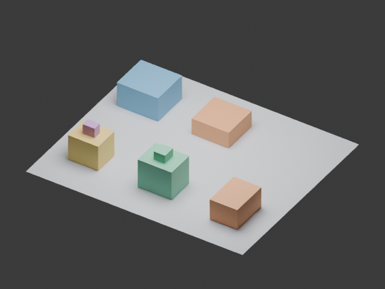
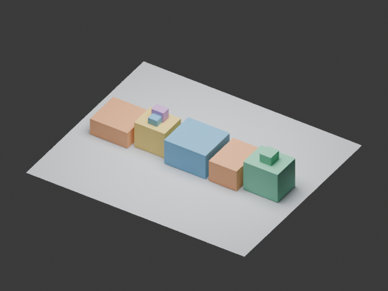

# 3D layout integration pilot — 2026-10-22

This pilot verifies the integration and reports no demonstrated RSI advantage.

| Program | Dev score (6 scenes) | Dev strict success | Heldout score (8 scenes) | Heldout strict success |
|---|---:|---:|---:|---:|
| initial | 0.6738 | 0% | 0.6831 | 0% |
| e0 | 1.0000 | 100% | 1.0000 | 100% |
| adaptive_e1 | 1.0000 | 100% | 1.0000 | 100% |
| fixed_e1 | 1.0000 | 100% | 1.0000 | 100% |

Programs are selected by development score before heldout evaluation. The heldout set varies room/object dimensions and relations within the same generator; it is not a new task family.

The policy rewrite and its application in E1 completed. Its SHA256 matches the selected policy. The rewrite tied the incumbent on replay and was selected by the newer-candidate tie rule. Shared E0 had already saturated this small task; the pilot does not establish improved quality or lower total cost.

Both renders use development scene 0 and the same camera. [Generated GLB](best.glb) was reimported into Blender 4.5.11 LTS with all eight object dimensions and centers checked. Numeric scoring is independent of the renderer.

## Resource accounting

| Stage | Agent episodes | Reported input tokens | Cached input tokens | Output tokens |
|---|---:|---:|---:|---:|
| shared_e0 | 4 | 112538 | 0 | 14702 |
| adaptive_learning | 1 | 34330 | 0 | 4668 |
| adaptive_e1 | 4 | 267922 | 13312 | 15283 |
| fixed_e1 | 4 | 267977 | 0 | 14857 |
| ordinary_codex_workspace_access_failures | 4 | 541695 | 466816 | 2167 |
| discarded_policy_rewrite_on_stale_trace | 1 | 34311 | 0 | 4843 |

Shared E0 is counted once. These are CLI-reported token counters, not dollar charges or proof of equal compute. Each agent episode can contain many underlying model requests. Raw logs remain local.

## Provenance and limits

- Single shared starting trace and one policy rewrite: feasibility pilot, not evidence of RSI gains.
- Equal online episode caps do not equal token/compute budgets; policy rewrite adds cost.
- Heldout solver performance is not evidence of policy transfer to new task families.
- Cuboid constraints and mesh roundtrip do not measure arbitrary asset quality.
- All four original model outputs retained and independently rescored after correcting a startup warning parser. E0 refinement prompts had host-failure feedback; L0 in this directory starts afresh using only the corrected positive trace. Engineering pilot, not a clean efficacy experiment.
- The prior L0 used a stale trace and was discarded. The reported fresh L0 used corrected positive trace scores.
- The new policy tied the incumbent and was selected by the upstream tie-breaking rule, not a strict improvement.
- E1 arms were launched independently in parallel, one worker each; elapsed times are not a controlled performance benchmark.
- One E0 candidate uses a wall-clock search limit and is not strictly deterministic; it was not the selected champion. Source inspection found fixed iteration budgets in all eight E1 candidates and no external I/O in the sampled solvers. This is not a formal sandbox guarantee.

Validation: 160 tests passed, 10 skipped, 2 deselected. Optional KernelBench client dependencies were installed for the full offline suite. The Windows symlink-privilege test and the upstream real-agent integration test were excluded; live code generation was exercised separately here.

See [aggregate metrics](metrics.json), [setup and protocol](../../docs/3D_BASELINE.md), and [framework audit](../../docs/FRAMEWORK_AUDIT.md). No generated source, prompt or result was used to change the frozen evaluator.
